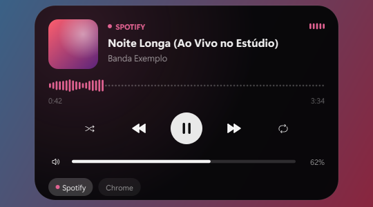

# Music Video Bar

Ilha dinâmica para o Windows: mostra o que está tocando (Spotify, YouTube/Twitch/Netflix no navegador, VLC, Media Player…) numa pílula no topo da tela, que vira uma central de controle ao passar o mouse.



## Instalação

Precisa de Windows 10/11 e Python 3.11+.

```
git clone https://github.com/data-matheus/music-video-bar.git
cd music-video-bar
python -m venv .venv
.venv\Scripts\python -m pip install -r requirements.txt
```

Depois é só abrir `Iniciar.bat`. Para iniciar com o Windows, marque a opção no menu do ícone da bandeja.

## Como testar

1. Dê dois cliques em **`Iniciar.bat`**. Um ícone de pílula aparece na bandeja (perto do relógio).
2. Dê play em alguma coisa (Spotify, um vídeo no YouTube…).
3. Confira o roteiro abaixo.

| O que fazer | O que deve acontecer |
|---|---|
| Tocar algo com a área de trabalho ou uma janela não maximizada embaixo | Pílula no topo com capa, título e a onda do som rolando |
| Mesma coisa com o navegador **maximizado** | Vira uma linha fina de progresso com a onda; as abas continuam clicáveis |
| Deixar a música tocando com a central aberta | A timeline vira uma onda estilo SoundCloud, desenhada conforme toca |
| Passar o mouse na pílula (ou encostar o mouse no **topo-centro** da tela) | Abre a central: capa, timeline, controles, volume |
| Arrastar a timeline | Pula para aquele ponto do vídeo/música |
| Clicar na capa | Traz o app que está tocando para a frente |
| Rodinha do mouse sobre a ilha | Muda o volume do sistema |
| Mudar o volume pelo teclado/Windows | Aparece o HUD de volume na ilha |
| Trocar de faixa | A ilha cresce mostrando a nova música por ~3 s |
| Spotify **e** YouTube abertos | Botões ("chips") embaixo para escolher qual controlar |
| Abrir um jogo/vídeo em tela cheia | A ilha some |
| `Ctrl+Alt+M` | Abre/fecha a central |
| Clique do meio na ilha | Play/pause |
| Botão direito na ilha ou no ícone da bandeja | Configurações e **Sair** |

**Modo demo** (músicas falsas, não mexe no que está tocando): feche a versão normal (bandeja → Sair) e abra `Demo.bat`.

## Configurações (menu da bandeja)

- Expandir ao passar o mouse
- Modo discreto sobre janelas maximizadas
- Esconder quando nada toca
- Esconder em tela cheia
- HUD de volume
- Aviso ao trocar de faixa
- Iniciar com o Windows

## O que tem de diferente dos apps parecidos

Pesquisei no GitHub e no X (DynamicWin, BrimDeck, fly-island, eIsland, NetSpeed-Dynamic, Ripple, Poni, flexflyout…). A maioria mistura muita coisa (cota de IA, WeChat, clipboard, calendário) ou só imita o flyout de volume. Este aqui foca em mídia e corrige o que mais incomoda neles:

- **Não atrapalha o navegador**: sobre janela maximizada vira uma linha que deixa o clique passar.
- **Onda de verdade**: lê o nível do som de cada app (funciona até com mixers virtuais como o SteelSeries Sonar), não é animação fake. A onda da timeline é gravada enquanto a música toca; o trecho que ainda não tocou fica pontilhado.
- **Cor da capa**: a cor de destaque é extraída da capa e muda suavemente entre faixas.
- **Vídeo tem capa 16:9**: miniaturas de YouTube aparecem largas, sem corte.
- **Várias fontes**: escolhe sozinho quem está tocando (e segue quem começar a tocar), com chips para trocar na mão.
- **Timeline arrastável** com posição estimada entre as atualizações do app.
- **HUD de volume próprio**, rodinha para volume, clique na capa para focar o app.
- **Some em tela cheia** (jogos, vídeos, apresentações).
- Leve: atualiza a 30 fps só enquanto toca; parado, quase não usa CPU.

## Estrutura

```
main.py            entrada, bandeja, menu, snapshots (--snapshot PASTA)
island/media.py    sessões de mídia do Windows (GSMTC) numa thread própria
island/audio.py    volume e medidor de pico (Core Audio / pycaw)
island/ui.py       a ilha: desenho, molas, interação
island/winutil.py  Win32: janela sob a ilha, focar app, atalho, autostart
island/demo.py     backend falso para o modo demo
tests/             testes da lógica: .venv\Scripts\python -m unittest discover tests
```

Log: `%LOCALAPPDATA%\MusicVideoBar\log.txt`.
